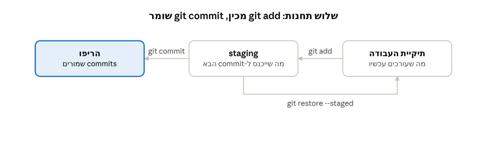

# שיעור 1 · יסודות: מה זה git ואיך עובדים איתו בצוות

## מהלך השיעור

השיעור מתחיל בתרגיל בלי git ומסתיים ב-PR שעובר code review. כל ההדגמה נעשית על פרויקט קטן אחד, `calc`: קובץ Python שגדל לאורך השיעור.

| דקות | חלק | מה מדגימים |
| --- | --- | --- |
| 0-11 | בלי git: תרגיל פתיחה | שלישיות, קובץ Java אחד שבו כל פונקציה בנויה על הקודמת, וסנכרון בוואטסאפ או בדרייב |
| 11-17 | מה קרה? | מריצים את הקבצים הסופיים, ומה שהשתבש עולה על הלוח |
| 17-26 | מה זה git | היסטוריה מלאה בכל מחשב; git מול GitHub; הגדרות ראשונות |
| 26-56 | שלושת המצבים | `init`, `status`, `add`, `restore`, `commit`, `diff`, `log`, `.gitignore` |
| 56-74 | branch ו-merge | `switch -c`, fast-forward, merge commit, `log --graph` |
| 74-84 | הפסקה | |
| 84-104 | עבודה עם אחרים | `clone`, `push` שנדחה, `pull`, וההבדל מ-`fetch` |
| 104-128 | PR ו-code review | פתיחת PR, הערה על שורה, תיקון באותו branch, אישור ומיזוג |
| 128-135 | סיכום והלולאה היומית | הלולאה מ-`pull` ועד מחיקת ה-branch, שלושה דברים לזכור, ומעבר לתרגול |

## ההדגמה

כל הפקודות כאן רצו בריפו בדיקה על git 2.43, בסדר שבו הן מופיעות. מהחלק "עבודה עם אחרים" צריך ריפו הדגמה ריק ב-GitHub, `calc-demo`.

### בלי git: תרגיל פתיחה (0-11)

לפני שמזכירים את המילה git, הכיתה עובדת כמו שעובדים בלעדיו: שלישיות, קובץ Java אחד, וכל אחד משלים בו פונקציה אחת. הפונקציות בנויות זו על זו: `mul` משתמשת ב-`add`, ו-`power` משתמשת ב-`mul`. כך אי אפשר לבדוק את החלק שלך בלי הקוד של חבר. מסנכרנים בוואטסאפ או בדרייב, איך שרוצים.

לפני השיעור: קבוצת וואטסאפ או תיקיית דרייב לכיתה עם `Calc.java`, ו-`javac` שעובד בכל מחשב. זה הקובץ שכולם מקבלים:

```java
// Authors:
public class Calc {
    // A: returns a + b
    static int add(int a, int b) {
        return 0; // TODO
    }

    // B: returns a * b, using only add (repeated addition)
    static int mul(int a, int b) {
        return 0; // TODO
    }

    // C: returns a to the power of b, using only mul (repeated multiplication)
    static int power(int a, int b) {
        return 0; // TODO
    }

    public static void main(String[] args) {
        System.out.println("2 + 3 = " + add(2, 3));
        System.out.println("3 * 4 = " + mul(3, 4));
        System.out.println("2 ^ 5 = " + power(2, 5));
    }
}
```

| מי | מה משלים | תלוי ב- |
| --- | --- | --- |
| א' | `add` מחזירה `a + b` | |
| ב' | `mul` מחזירה `a * b`, רק בעזרת `add` (חיבור חוזר) | א' |
| ג' | `power` מחזירה `a` בחזקת `b`, רק בעזרת `mul` (כפל חוזר) | א' וב' |
| כולם | מוסיפים את השם לשורה הראשונה, `// Authors:` | |

הכללים, על הלוח:

- כל אחד כותב ומריץ את הקוד אצלו: `javac Calc.java && java Calc`.
- מסנכרנים איך שרוצים: וואטסאפ, דרייב.
- בדקה 11: קובץ אחד לצוות, שמדפיס 5, 12 ו-32, ושלושה שמות בשורת Authors.

| דקה | מה קורה |
| --- | --- |
| 0-3 | חלוקה לשלישיות, הכללים, והקובץ נשלח לקבוצה |
| 3-11 | עבודה. לא מזכירים git, ולא עוזרים להסתנכרן |
| 7 | הודעה מראש הצוות: "add נקראת מעכשיו sum." כל מי שקורא ל-add צריך לעדכן |
| 11 | כל צוות שולח לקבוצה קובץ אחד, עם שם הצוות |

המלכודת: ב' ו-ג' לא יכולים לבדוק את הקוד שלהם בלי הקוד של א', אז קבצים שלמים עוברים הלוך ושוב באמצע העבודה, וכל העברה דורסת משהו. עותק בלי `add` מדפיס 0, 0, 0 גם כש-`mul` ו-`power` נכונות. אחרי השינוי ל-`sum`, קובץ שבו `mul` עדיין קוראת ל-`add` לא מתקמפל.

### מה קרה? (11-17)

פותחים את הקובץ הסופי של 2-3 צוותים ומריצים אותו. קובץ אופייני מדפיס 0, 0, 0, או נופל בקומפילציה עם `cannot find symbol` על `add`. בשורת Authors יש שם אחד.

שאלות לכיתה:

- מי חיכה לקוד של מי, ואיך הוא הגיע אליו?
- מה הקובץ הסופי הדפיס, וכמה שמות יש בשורת Authors?
- מה קרה כש-`add` הפכה ל-`sum`?
- מי שינה את `add` לאחרונה, ואיך חוזרים לגרסה שעבדה?

לצוות שהצליח שואלים: מי איחד ביד, ואיך ידע שלא הלך משהו לאיבוד? ומה יהיה עם 30 אנשים?

כותבים על הלוח את מה שהשתבש, ולאורך השיעור חוזרים אליו:

| מה קרה בתרגיל | מה git נותן | איפה בקורס |
| --- | --- | --- |
| ב' ו-ג' חיכו לקוד של א', וקבצים שלמים עברו הלוך ושוב | `pull` מביא רק את מה שחברים כבר דחפו | השיעור הזה |
| פונקציות שהדפיסו 0: קובץ שלם דרס שינוי של חבר | merge מאחד לבד שינויים בשורות שונות | השיעור הזה |
| `add` הפכה ל-`sum`, וקבצים ישנים לא מתקמפלים | השינוי וכל הקריאות לפונקציה נכנסים ב-commit אחד, וכולם מושכים אותו יחד | השיעור הזה |
| שורת Authors: שלושה שינו אותה שורה | על אותה שורה git עוצר ושואל: קונפליקט | שיעור 2 |
| אף אחד לא יודע איזה קובץ אחרון, ואי אפשר לחזור לגרסה שעבדה | היסטוריה: כל commit שומר מי, מתי ולמה, ואפשר לחזור אליו | השיעור הזה, ושיעורים 2 ו-4 |

ההמשך: ההדגמה של השיעור בונה מחשבון עם git, ב-`calc.py`.

### מה זה git (17-26)

- git שומר צילום (snapshot) של כל הפרויקט בכל commit, עם מחבר, תאריך והסבר.
- לכל מחשב יש עותק מלא של ההיסטוריה. git לא צריך שרת כדי לעבוד.
- GitHub הוא אתר שמאחסן ריפו של git ומוסיף עליו PR, issues והרשאות.

הגדרות שכל חניך מריץ פעם אחת:

```
git config --global user.name "Your Name"
git config --global user.email "you@example.com"
git config --global init.defaultBranch main
git config --global pull.rebase false
```

בלי `pull.rebase`, הפקודה `git pull` על branch שהתפצל נכשלת עם `fatal: Need to specify how to reconcile divergent branches`. בשיעור 2 מחליפים את הערך ל-`true`.

### שלושת המצבים (26-56)



החץ החוזר מוציא שינוי מ-staging בלי למחוק אותו. `git restore calc.py` בלי `--staged` זורק שינוי שעוד לא הגיע לשום תחנה, ולכן אין ממנו דרך חזרה.

קובץ עובר מהתיקייה (working directory), דרך אזור ההכנה (staging), אל הריפו (commit). כותבים את `calc.py` עם פונקציה `add()`, ומריצים:

```
mkdir calc && cd calc
git init
git status                 # ?? calc.py
git add calc.py
git status                 # A  calc.py
git commit -m "Add calculator with add()"
```

מוסיפים `sub()`, ויוצרים קובץ `.env` עם סיסמה:

```
git status                 #  M calc.py   ?? .env
git diff
git add calc.py
git diff --staged
git restore --staged calc.py   # מוציא מ-staging, השינוי נשאר בקובץ
echo ".env" > .gitignore
git add .gitignore calc.py
git commit -m "Add sub() and ignore .env"
git log --oneline
```

עכשיו מוחקים שורה בטעות ומריצים `git restore calc.py`. השורה חוזרת, וכל שינוי שלא נכנס ל-commit נמחק לתמיד.

שאלות לכיתה:

- למה צריך staging, ולא commit ישר על כל השינויים? (כדי לבנות commit של שינוי אחד)
- לפני `git restore calc.py`: השינוי לא נמצא באף commit. לאן הוא ילך?
- סיסמה נכנסה ל-commit, וב-commit הבא מחקנו אותה. האם היא עדיין בריפו? (כן, בהיסטוריה)

### branch ו-merge (56-74)

```
git switch -c add-mul
# מוסיפים mul()
git commit -am "Add mul()"
git switch main
git merge add-mul          # Fast-forward
git branch -d add-mul
git switch -c add-div
# מוסיפים div()
git commit -am "Add div()"
git switch main
# כותבים README.md
git add README.md
git commit -m "Add README"
git merge add-div          # Merge made by the 'ort' strategy
git log --oneline --graph --all
```

שאלות לכיתה:

- לפני ה-merge הראשון: האם ייווצר commit חדש? (לא. main פשוט מתקדם קדימה)
- ומה עכשיו, כששני הצדדים התקדמו? (merge commit עם שני הורים)

### עבודה עם אחרים (84-104)

שותף לעבודה מדומה הוא תיקייה שנייה, `calc-moshe`. עוד יותר טוב: חניך מתנדב שדוחף מהמחשב שלו.

```
git remote add origin https://github.com/<org>/calc-demo.git
git push -u origin main
cd .. && git clone https://github.com/<org>/calc-demo.git calc-moshe
# ב-calc-moshe: משנים את README.md, ואז commit ו-push
# ב-calc: משנים את calc.py, ואז commit
git push                   # ! [rejected] main -> main (fetch first)
git pull                   # ממזג את העבודה של משה
git push
git log --oneline --graph -6
```

שאלות לכיתה:

- לפני ה-push השני: מה יקרה? (נדחה, כי בשרת יש עבודה שאין אצלנו)
- מה ההבדל בין `git fetch` ל-`git pull`? (pull = fetch ואז merge)
- אם GitHub נמחק מחר, מה מההיסטוריה הולך לאיבוד? (כלום: כל clone מלא)

אם הרשת נופלת, `git init --bare ../server.git` ישמש כשרת מקומי, וכל הדגמת ה-push וה-pull עובדת מולו.

### PR ו-code review (104-128)

1. דוחפים את `fix-div-by-zero` (בדיקה של חלוקה באפס), ופותחים PR.
2. כותרת ותיאור: מה השתנה, למה, ואיך בדקתי. `Closes #1` סוגר את ה-issue במיזוג.
3. בתור סוקר: הערה על שורה, ו-Request changes.
4. בתור כותב: commit ו-push לאותו branch. ה-PR מתעדכן לבד.
5. Approve, מיזוג ומחיקת ה-branch. את שלוש אפשרויות המיזוג משאירים לשיעור 5.
6. במחשב: `git switch main`, `git pull` ו-`git branch -d fix-div-by-zero`.

למי שעובד עם הטרמינל, אותו התהליך ב-GitHub CLI: `gh pr create --fill`, `gh pr checkout 1`, `gh pr review --approve`, `gh pr merge --squash --delete-branch`.

על מה מסתכלים ב-review:

- האם השינוי עושה מה שה-PR מבטיח, ורק את זה?
- האם השמות ברורים, והאם נשכח מקרה קצה?
- הערה שלא חובה לתקן מסמנים `Nit:`, כמו ב-[הנחיות של Google](https://google.github.io/eng-practices/review/reviewer/standard.html).
- מאשרים כשהשינוי משפר את הקוד, גם אם הוא לא מושלם.

שאלות לכיתה: מה גודל טוב ל-PR? איך כותבים הערה על הקוד בלי לפגוע בכותב?

### סיכום והלולאה היומית (128-135)

זו הלולאה שחוזרת על עצמה כל יום, לפי [GitHub flow](https://docs.github.com/en/get-started/using-github/github-flow):

1. `git switch main` ו-`git pull`
2. `git switch -c fix-div-by-zero`
3. עורכים, ובודקים עם `git status` ו-`git diff`
4. `git add -p` כדי לבחור חלקים, ואז `git commit`
5. `git push -u origin fix-div-by-zero`
6. PR, review ותיקונים באותו branch
7. מיזוג, מחיקת ה-branch ו-`git pull` ב-main

שלושה דברים לזכור: commit קטן של שינוי אחד, branch לכל שינוי, ושום דבר לא מגיע ל-main בלי review. אחר כך מחלקים לחברותות ועוברים לתרגול.

## תרגול (120 דקות)

שני חלקים, משחק ויזואלי ותרגיל קשה בטרמינל, עם פתיחה וסיום קצרים:

| דקות | חלק | מה עושים |
| --- | --- | --- |
| 0-5 | פתיחה | חברותות: אחד מקליד, אחד מכוון, ומתחלפים בכל שלב |
| 5-55 | Learn Git Branching | עד סוף שלב 6 ב-Push & Pull |
| 55-70 | git-exercises: התקנה | clone, כינוי ומייל, `./configure.sh` ו-`git start` |
| 70-115 | git-exercises: תרגילים 1-6 | פותרים, ומריצים `git verify` אחרי כל תרגיל |
| 115-120 | סיום | בודקים ב-My progress ששישה תרגילים פתורים |

### חלק א': Learn Git Branching (50 דקות)

ב-[Learn Git Branching](https://learngitbranching.js.org) כותבים `levels` כדי לפתוח את תפריט השלבים. המשחק באנגלית, ואין בו עברית.

| לשונית | רצף | שלבים | מה מתרגלים |
| --- | --- | --- | --- |
| Main | Introduction Sequence | 1–4 (כולם) | commit, branch, merge, וטעימה ראשונה מ-rebase |
| Main | Moving and Staging Work | 3–4 בלבד | The Staging Area, ו-Undoing with git restore |
| Remote | Push & Pull | 1–6 | clone, remote branches, fetch, pull, push |

עוצרים לפני שלב 7 ב-Push & Pull. הוא עוסק בהיסטוריה שהתפצלה, ופותח את שיעור 2.

### חלק ב': git-exercises, התרגיל הקשה (60 דקות)

[git-exercises](https://gitexercises.fracz.com) של AGH הוא סדרה של 23 תרגילים ב-git אמיתי. השרת שלהם בודק כל פתרון. האתר פעיל, ופתרונות חדשים מופיעים בו כל כמה דקות.

```
git clone https://gitexercises.fracz.com/git/exercises.git
cd exercises
git config user.name "nickname"
git config user.email "you@example.com"
./configure.sh
git start
```

פותרים, מריצים `git verify`, ועוברים הלאה עם `git start next`. הפקודה `git verify` דוחפת בכוח את ה-HEAD לשרת שלהם, והשרת מחזיר תשובה.

| # | תרגיל | מה נבדק |
| --- | --- | --- |
| 1 | master | שהכל מוגדר נכון |
| 2 | commit-one-file | commit של קובץ אחד מתוך שניים |
| 3 | commit-one-file-staged | הוצאת קובץ מ-staging |
| 4 | ignore-them | `.gitignore` |
| 5 | chase-branch | merge של branch שהתקדם |
| 6 | merge-conflict | קונפליקט ראשון, לפני שלמדנו אותו |
| 7 (בונוס) | save-your-work | למצוא לבד את הכלי המתאים (stash) |

חשוב לדעת לפני שמתחילים:

- **השם מופיע ברבים.** ה-`user.name` שהוגדר בתיקייה הזו מופיע ברשימת "Latest solutions" הציבורית באתר. עדיף כינוי. ההתקדמות נמצאת ב-My progress, לפי המייל.
- **ב-Windows עובדים ב-Git Bash**, כי `configure.sh` הוא סקריפט shell.
- **תרגילים 22–23 לא מתאימים לקבוצה.** find-swearwords ו-find-bug בנויים על קללות באנגלית. לא מטפלים בהם בכלל, ותרגיל bisect נותנים מ-git-katas בשיעור 4.
- **תרגיל 6 מגיע לפני שיעור 2 בכוונה.** מי שנתקע שם מגיע לשיעור הבא עם שאלה טובה.

קריטריון הצלחה: ששת התרגילים הראשונים מסומנים כפתורים ב-My progress.

אם האתר חסום ברשת המכללה, עוברים ל-[git-katas](https://github.com/eficode-academy/git-katas), שעובד מקומית אחרי clone אחד. עושים את שבעת הראשונים ב-Basic Track, מ-`basic-commits` עד `merge-mergesort`.

### מסלול למתקדמים: GitMastery

מי שמסיים מוקדם ממשיך ב-[GitMastery](https://gitmastery.me). זה טרמינל מדומה עם פקודות git אמיתיות, ב-13 שלבים ו-55 משימות. ההתקדמות נשמרת בדפדפן, וחשבון הוא רשות. לשיעור הזה: Introduction to Git, File Operations, Working with Branches ו-Merging Branches (18 משימות).
