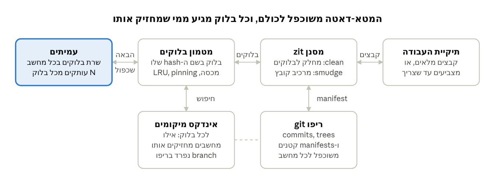

# zit — הערות למדריך

פרק זה לא לחניכים: פתרון לדוגמה ורעיונות להכוונה.

## ארכיטקטורה לדוגמה

ב-checkout, smudge מבקש את הבלוקים מהמטמון. בלוק חסר נמצא דרך האינדקס, מגיע מעמית ונבדק מול ה-hash שלו. ב-push הכיוון הפוך: הבלוקים החדשים משוכפלים ל-N עמיתים, האינדקס מתעדכן, ורק אז `git push` של ה-manifests. זו דרך אחת מני רבות, כדי שתוכל לשאול שאלות מכוונות. צוות שבוחר אינדקס מרכזי או קבצים שלמים במקום בלוקים לא טועה, אם הוא מסביר את המחיר ב-ADR.

## רעיונות לפיצ'ר מיוחד

צוות תקוע מקבל שאלה מכוונת מהעמודה האחרונה, ולא את הרעיון. כך הפיצ'ר נשאר שלהם.

| רעיון | מה הוא פותר | שאלה שמכוונת אליו |
| --- | --- | --- |
| הורדה מקבילית מכמה מחשבים | קובץ ענק מגיע מהר יותר | למה להוריד ממחשב אחד, כשלשלושה יש את הקובץ? |
| בחירת המחשב הקרוב או המהיר | פחות המתנה, עדיפות לרשת המקומית | מחשב באותו חדר, ומחשב בחו"ל. ממי תורידו? |
| חלוקה לבלוקים לפי תוכן | שינוי קטן בקובץ ענק מעביר רק את הבלוקים שהשתנו | הוספתם בית אחד בתחילת סרט. כמה בלוקים השתנו? |
| הורדה מראש חכמה | הקובץ כבר מחכה כשפותחים אותו | עברתם ל-branch אחר. אילו קבצים כנראה תפתחו עכשיו? |
| pinning ומכסת דיסק | קבצים חשובים נשארים תמיד, והדיסק לא מתמלא | נשארו 20GB פנויים. מה zit מוחק ראשון? |
| שכפול מחדש אוטומטי | מספר העותקים נשמר גם כשמחשב עוזב | חבר עזב את הצוות עם המחשב. מה אבד? |
| הצפנה אצל העמיתים | מחשב מחזיק בלוקים שהוא לא יכול לקרוא | מה המחשב של חבר יודע על הקבצים שלכם? |
| בדיקת שלמות תקופתית | מגלים מחשב שמחזיק בלוק פגום לפני שצריך אותו | איך תדעו שבלוק נפגם, עוד לפני שמישהו ביקש אותו? |
| תצוגה מקדימה | רואים מה יש בסרט בלי להוריד את כולו | צריך רק למצוא את הסרט הנכון מתוך מאה. מה מספיק? |

## היקף מינימלי למימוש הבונוס

מימוש שמקבל בונוס מלא לא צריך רשת אמיתית: מספיק שלוש תיקיות שמדמות שלושה מחשבים, ו-git רגיל שמנהל את השאר.

1. **חיבור ל-git דרך filter.** ב-`.gitattributes` השורה `*.bin filter=zit`, ובהגדרות `filter.zit.clean` ו-`filter.zit.smudge`. [clean רץ ב-`git add`, ו-smudge ב-checkout](https://git-scm.com/docs/gitattributes). הפקודות קוראות מ-stdin וכותבות ל-stdout, כמו שהתיעוד ממליץ.
2. **clean.** מחלק את הקובץ לבלוקים, שומר כל בלוק במטמון המקומי לפי ה-SHA-256 שלו, ומחזיר ל-git קובץ manifest קטן עם רשימת ה-hashes.
3. **`zit push`.** מעתיק בלוקים חסרים ל-N מחשבים, מעדכן את אינדקס המיקומים (hash לרשימת מחשבים), ורק אז מריץ `git push`.
4. **smudge.** קורא manifest, מביא כל בלוק מהמטמון או ממחשב שמחזיק אותו, בודק את ה-hash, ומרכיב את הקובץ.
5. **`zit where <file>`.** מדפיס אילו מחשבים מחזיקים כל בלוק.

שלוש בדיקות שצריכות לעבור:

- [ ] הלוך וחזור: add, push, מחיקת המטמון המקומי ו-checkout מחדש מחזירים קובץ זהה ביט בביט
- [ ] בלוק פגום אצל מחשב אחד נדחה בבדיקת ה-hash, ומגיע ממחשב אחר
- [ ] מחשב כבוי לא מפיל את checkout כל עוד יש עותק אחר

דרישה לקוד: בלי ערכים קשיחים בלוגיקה. גודל הבלוק, מספר העותקים ורשימת המחשבים מגיעים מ-git config, למשל `zit.chunkSize`, `zit.replicas` ו-`zit.peers`.
